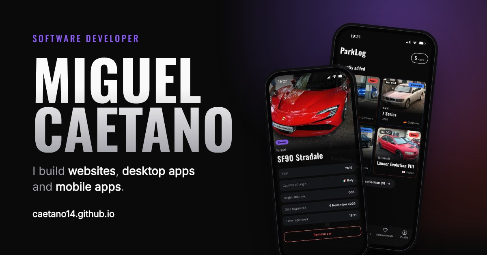

# caetano14.github.io

My personal portfolio: **[caetano14.github.io](https://caetano14.github.io)**

I'm Miguel Caetano, a software developer building websites, desktop apps and mobile apps.
This site presents who I am and what I build, with case studies of [ParkLog](https://caetano14.github.io/parklog/), my main personal project, and the [mobile app I worked on during my internship](https://caetano14.github.io/internship/).

[](https://caetano14.github.io)

## Highlights

- **No frameworks, no build step.** Plain HTML, CSS and JavaScript, hosted on GitHub Pages.
- **Bilingual (EN/PT).** A small custom i18n script: English by default, Portuguese when the browser is in Portuguese, and the visitor's choice is remembered.
- **Responsive.** Designed for phone, tablet and desktop, with a mobile menu.
- **Accessible.** Text contrast checked against WCAG AA, alt text on every image, keyboard focus styles, and animations turned off for visitors who prefer reduced motion.
- **Fast.** Screenshots served as WebP, with smaller versions for small screens, and lazy-loaded below the fold. No layout shift.
- **Ready to share.** Open Graph images for social networks, a favicon set and a custom 404 page.

## Structure

```
index.html            home page
parklog/              ParkLog case study → /parklog/
internship/           internship case study → /internship/
404.html              page shown for broken links
style.css             shared styles
case-study.css        styles shared by the case study pages
script.js             navigation, mobile menu, scroll animations
i18n.js               Portuguese translations and the language toggle
assets/               screenshots, share images
favicon.svg, *.png    icons
```

## How the translations work

The HTML is written in English. Translatable elements carry a key, and `i18n.js` holds the Portuguese text for each key:

```html
<h2 data-i18n="about.title">I like turning ideas into apps people actually want to use.</h2>
```

```js
"about.title": "Gosto de transformar ideias em apps que dá vontade de usar.",
```

Attributes such as `alt` or `href` use `data-i18n-attr="alt:key"`.

## Run it locally

Open the folder in VS Code and start it with the **Live Server** extension, or run any static server:

```bash
npx serve .
```

The 404 page uses absolute paths, so it only renders correctly when served from the root of a web server.

## Contact

[miguelscaetano.dev@gmail.com](mailto:miguelscaetano.dev@gmail.com) · [GitHub](https://github.com/caetano14)

---

© Miguel Caetano. Content and images in this repository are not licensed for reuse.
